<!-- ═══════════════════════════  HEADER  ═══════════════════════════ -->
<div align="center">



<br/><br/>

<a href="https://linkedin.com/in/upmanyu-singh30"></a>
<a href="mailto:upmanyu.work@gmail.com"></a>
<a href="https://instagram.com/Upmanyu_30"></a>


</div>

<br/>

<!-- ═══════════════════════════  WHOAMI  ═══════════════════════════ -->


I'm a third-year CS undergrad at **JIIT Noida** who likes building things end to end: the model, the API, the interface, and the visuals around it. I split my time between **full-stack development**, **ML research**, and **graphic design**.

```js
const upmanyu = {
  location  : "Noida, India",
  education : "B.Tech CSE @ JIIT Noida (3rd year)",
  focus     : ["DSA in C++", "Full Stack", "ML / AI Research"],
  club      : "Neural Nexus (AIML Club), CICR (robotics club), software team",
  design    : "Official merchandise for DebSoc, IIT Bombay",
  goal      : "SDE / ML internship",
};
```

<!-- ═══════════════════════════  NOW  ═══════════════════════════ -->


| | What | Details |
|:-:|:--|:--|
| 🌊 | **AntiFoul-AI v2** | Rebuilding my biofouling-risk model for underwater robots from scratch, backend first |
| 🤖 | **July** | My own AI agent that can read and edit GitHub repos, analyse CSVs, and send email |
| 🧩 | **DSA** | Daily C++ practice on LeetCode, aiming for an SDE internship |

<!-- ═══════════════════════════  PROJECTS  ═══════════════════════════ -->


<table>
  <tr>
    <td width="50%" valign="top">
      <h3>🌊 AntiFoul-AI</h3>
      Predicts how badly marine organisms will foul an underwater robot at a given location, then recommends traditional Indian antifouling compounds.
      <br/><br/>
      <b>·</b> Risk model trained on OBIS + GBIF ocean data<br/>
      <b>·</b> 216 fouling species in 12 categories<br/>
      <b>·</b> 🔬 Research project at JIIT
      <br/><br/>
      
      
      
      
      <br/><br/>
      <a href="https://github.com/UpmanyuCodes/AntiFoul-AI-v2"></a>
    </td>
    <td width="50%" valign="top">
      <h3>🩺 HealSync</h3>
      AI-powered healthcare platform, built under hackathon time pressure.
      <br/><br/>
      <b>·</b> 🏅 Hackathon finalist<br/>
      <b>·</b> Node.js + Spring Boot services<br/>
      <b>·</b> PostgreSQL data layer
      <br/><br/>
      
      
      
      <br/><br/>
      <a href="https://github.com/UpmanyuCodes?tab=repositories&q=HealSync"></a>
    </td>
  </tr>
  <tr>
    <td width="50%" valign="top">
      <h3>🤖 July</h3>
      A tool-using AI agent I built step by step to learn how agents work.
      <br/><br/>
      <b>·</b> Reads repos and opens pull requests<br/>
      <b>·</b> Analyses CSV files and draws plots<br/>
      <b>·</b> Reads and sends email, with memory across chats
      <br/><br/>
      
      
      
      <br/><br/>
      <a href="https://github.com/UpmanyuCodes?tab=repositories&q=July"></a>
    </td>
    <td width="50%" valign="top">
      <h3>🍔 my-online-meals</h3>
      Full-stack food delivery web app.
      <br/><br/>
      <b>·</b> 🚀 End-to-end ordering flow<br/>
      <b>·</b> REST API with Express<br/>
      <b>·</b> MongoDB for menus and orders
      <br/><br/>
      
      
      
      <br/><br/>
      <a href="https://github.com/UpmanyuCodes?tab=repositories&q=my-online-meals"></a>
    </td>
  </tr>
</table>

<!-- ═══════════════════════════  TECH STACK  ═══════════════════════════ -->


<table>
  <tr>
    <td width="150"><b>Languages</b></td>
    <td></td>
  </tr>
  <tr>
    <td><b>Frontend</b></td>
    <td></td>
  </tr>
  <tr>
    <td><b>Backend</b></td>
    <td></td>
  </tr>
  <tr>
    <td><b>ML / Data</b></td>
    <td>
      
      
      
    </td>
  </tr>
  <tr>
    <td><b>Cloud</b></td>
    <td>&nbsp;</td>
  </tr>
  <tr>
    <td><b>Design &amp; Tools</b></td>
    <td>&nbsp;</td>
  </tr>
</table>

<!-- ═══════════════════════════  ACHIEVEMENTS  ═══════════════════════════ -->


| | Achievement | Where |
|:-:|:--|:--|
| 🏆 | **Top 20 of 524 teams** | Indo-Israeli Hackathon 2025 |
| 🩺 | **Hackathon finalist** | HealSync, AI healthcare platform |
| 🎨 | **Official merch designer** | DebSoc, IIT Bombay |
| 🔬 | **ML research** | AntiFoul-AI, JIIT Noida |

<!-- ═══════════════════════════  STATS  ═══════════════════════════ -->


<div align="center">


</div>

<details>
<summary><b>📈 Contribution graph</b></summary>
<br/>

</details>

<!-- LeetCode card: put your LeetCode username in place of YOUR_LEETCODE_ID, then delete this comment line and the closing one below.
<div align="center">

</div>
-->

<!-- ═══════════════════════════  SNAKE  ═══════════════════════════ -->
<!-- Needs .github/workflows/snake.yml in this repo. Delete this block if you skip the workflow. -->

<div align="center">
<picture>
  <source media="(prefers-color-scheme: dark)" srcset="https://raw.githubusercontent.com/UpmanyuCodes/UpmanyuCodes/output/github-snake-dark.svg"/>
  <source media="(prefers-color-scheme: light)" srcset="https://raw.githubusercontent.com/UpmanyuCodes/UpmanyuCodes/output/github-snake.svg"/>
  
</picture>
</div>

<!-- ═══════════════════════════  FOOTER  ═══════════════════════════ -->

<div align="center">

<br/>

**Open to SDE and ML internships.** The fastest way to reach me is [email](mailto:upmanyu.work@gmail.com) or [LinkedIn](https://linkedin.com/in/upmanyu-singh30).

<br/>


</div>
